# Write-up: Mitigación de Vulnerabilidades de CWE

**Práctica 2**

**Autor:** Juan Paroli


## Ejercicios

1. Inyección SQL (SQLi).
2. Cross Site Scripting (XSS).
3. File Upload.
4. Server Side Template Injection.
5. Almacenamiento inseguro.

## Ejercicio 1 - Inyección SQL (SQLi)

### Descripción de la aplicación

Esta aplicación web llamada "CineBuscador" permite buscar funciones de cine en una base de datos SQLite. Tiene un cuadro de búsqueda para filtrar las películas por el nombre y dos selectores para ordenar los resultados por nombre o por fecha, en sentido ascendente o descendente. Al mandar una búsqueda, la aplicación arma una consulta SQL con lo que ingresó el usuario y muestra en una tabla las funciones encontradas, con la película, la fecha y hora, y los asientos disponibles.

### Identificación de la vulnerabilidad

La vulnerabilidad está en la función `buscar_funciones` de `app.py`, que arma la consulta SQL de esta forma:

```python
def buscar_funciones(query, sort_by='nombre', sort_dir='ASC'):
    db = get_db()
    sql = f"SELECT peliculas.nombre as pelicula, funciones.fecha_hora, " \
          f"(funciones.asientos_totales - funciones.asientos_ocupados) as disponibles " \
          f"FROM funciones " \
          f"JOIN peliculas ON funciones.pelicula_id = peliculas.id " \
          f"WHERE peliculas.nombre LIKE '%{query}%' " \
          f"ORDER BY {'peliculas.nombre' if sort_by == 'nombre' else 'funciones.fecha_hora'} " \
          f"{sort_dir}"
    return db.execute(sql).fetchall()
```

La vulnerabilidad se da porque la consulta se arma con un f string, pegando directamente en el texto del SQL el valor de `query` (que viene del parámetro `buscar` del cuadro de búsqueda de la página) y el de `sort_dir` (que viene del parámetro `sentido` del selector, ascendente o descendente), sin ningún tipo de validación entre lo que es un dato y lo que es código. Como la base de datos recibe la consulta ya armada, no puede distinguir el texto que ingresó el usuario de las instrucciones SQL, por eso si ese texto tiene forma de SQL, lo termina ejecutando como parte de la consulta. Como detalle extra y aprovechando las presentaciones que estuvimos haciendo en clase, esta vulnerabilidad entraría en la weakness CWE-89 de inyección SQL.

La función tiene dos lugares donde se puede hacer inyección: 

- el parámetro `buscar` (o sea el `{query}`)
- el parámetro `sentido` (el `{sort_dir}` del final). 

El parámetro `ordenar_por` no es inyectable porque el código elige entre dos nombres de columna fijos con un if else.

### Prueba de concepto (PoC)

Primero levanté la aplicación desde la carpeta del ejercicio:

```bash
cd /home/kali/practico2/Ejercicio1
docker compose up --build
```

Con el contenedor corriendo entré desde el Firefox a `http://localhost:5000`, donde cargó la app de CineBuscador.

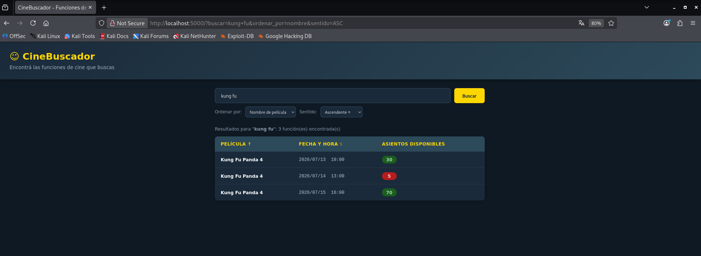

#### **1.1. Confirmar que es inyectable.**

Para confirmar que es inyectable, ingresé una sola comilla en el cuadro de búsqueda:

```
'
```

La aplicación me devolvió un error de SQL (`sqlite3.OperationalError: unrecognized token`), lo que me confirma que la comilla llegó hasta el motor de la base de datos y rompió la consulta, probando que el campo es inyectable. Además como la aplicación corre con `debug=True`, el error muestra el traceback completo con la consulta y el código interno, que termina siendo una fuga de información adicional.

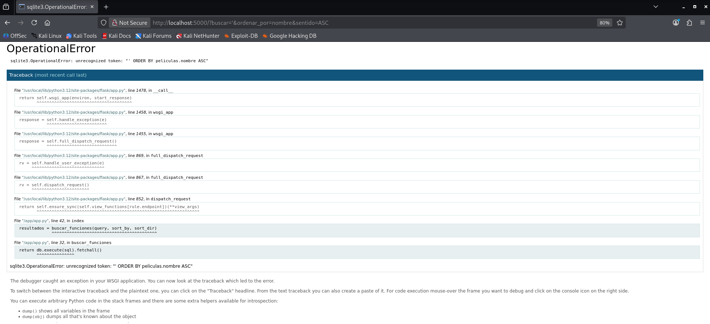

#### **1.2. Extracción de datos que la aplicación no expone.**

Aprovechando que la consulta original devuelve tres columnas, ingresé en el cuadro de búsqueda lo siguiente:

```
' UNION SELECT director, genero, id FROM peliculas-- 
```

Con esto la tabla pasó a incluir además de las funciones normales, las filas con el director, el género y el id de cada película, siendo datos que el buscador normal no expone. En la captura se ve que aparecen mezclados los resultados originales (nombres de películas con fecha y asientos) con los datos inyectados (nombres de directores), son 31 filas en total, las 21 funciones reales de la aplicación más las 10 de directores que traje con mi consulta.

Al principio no entendí por qué aparecían esas 31 filas en lugar de solo las de los directores. Después de investigar y apoyarme en la IA, entendí que esas filas de más aparecen porque el término de búsqueda quedó como LIKE '%', que coincide con todas las películas. La consulta original devuelve todas las funciones y el UNION le suma encima las filas de mi SELECT inyectado.

El comando empieza con la comilla que cierra el texto de la búsqueda, el `UNION SELECT` agrega una segunda consulta que trae otras columnas (que son tres para que coincida con la consulta original) y el `--` comenta la parte restante de la consulta original para que no dé un error.

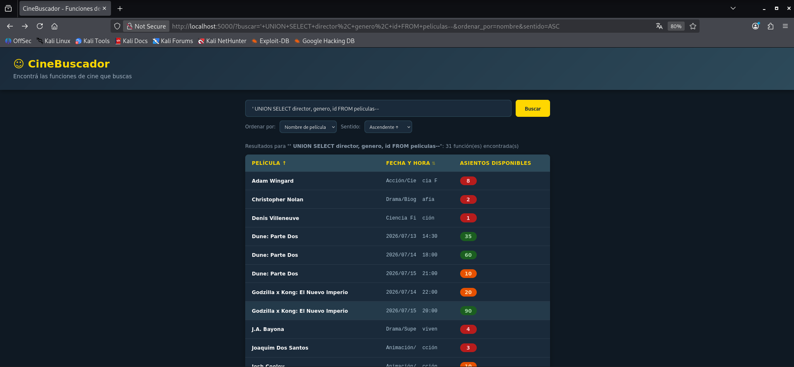

Como en ese resultado los datos inyectados aparecían mezclados con las funciones reales, quise también hacer un caso más mostrando solo la información que no debería poder ver. Para hacer eso repetí la inyección pero poniendo antes un texto que no coincide con ninguna película (por ejemplo `zzz`), para que la búsqueda original no devuelva ninguna fila y queden solo los datos de mi consulta:

```
zzz' UNION SELECT director, genero, id FROM peliculas-- 
```

Al no existir ninguna película que tenga "zzz" en el nombre, la parte original de la consulta (`LIKE '%zzz%'`) no devuelve nada y la tabla queda mostrando solo el director y el género de todas las películas.

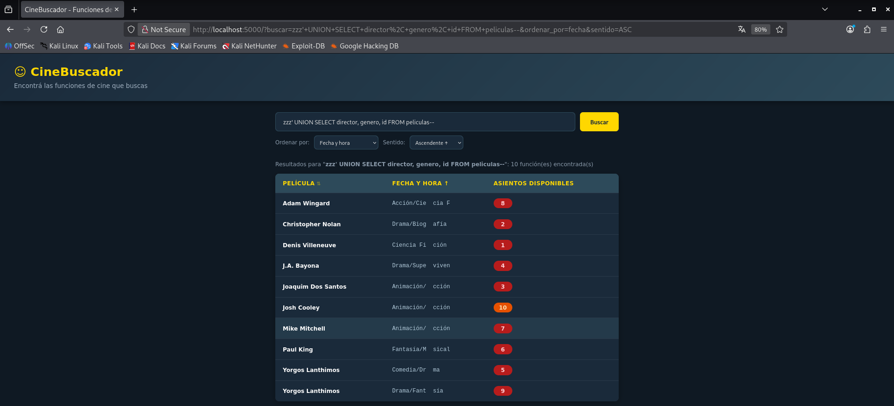

#### **1.3. Leer la estructura completa de la base.** 

Para mostrar un poco más el alcance de la vulnerabilidad, ingresé otro comando que consulta la tabla interna `sqlite_master` (además aislé el resultado como en el paso anterior):

```
zzz' UNION SELECT name, sql, 1 FROM sqlite_master WHERE type='table'-- 
```

La consulta devolvió el nombre y la definición (`CREATE TABLE`) de todas las tablas, mostrando cómo con la inyección se puede ver el esquema completo de la base. 

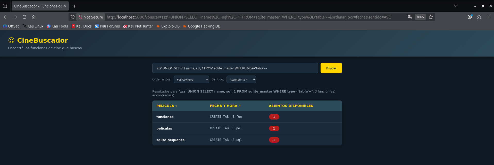

### Impacto de la vulnerabilidad

La vulnerabilidad permite a un atacante leer datos arbitrarios de la base de datos sin ningún tipo de autenticación, solo con inyectar una consulta en el cuadro de búsqueda. Pude extraer campos que la aplicación no expone y el esquema completo de la base. También el modo debug filtra información interna de la aplicación en los mensajes de error, siendo algo aprovechable para el atacante, ya que obtiene datos y detalles de la implementación que le facilitan seguir explotando el sistema.

### Mitigación

La aplicación tenía dos problemas para corregir, que eran la inyección SQL y el modo debug activo que filtraba información interna. Ambos los resolví con cambios en `app.py`.

#### Consulta parametrizada y white list

El origen de la vulnerabilidad como mostré antes era que la consulta se armaba concatenando directamente lo que ingresaba el usuario. La versión vulnerable era esta:

```python
def buscar_funciones(query, sort_by='nombre', sort_dir='ASC'):
    db = get_db()
    sql = f"SELECT peliculas.nombre as pelicula, funciones.fecha_hora, " \
          f"(funciones.asientos_totales - funciones.asientos_ocupados) as disponibles " \
          f"FROM funciones " \
          f"JOIN peliculas ON funciones.pelicula_id = peliculas.id " \
          f"WHERE peliculas.nombre LIKE '%{query}%' " \
          f"ORDER BY {'peliculas.nombre' if sort_by == 'nombre' else 'funciones.fecha_hora'} " \
          f"{sort_dir}"
    return db.execute(sql).fetchall()
```

La reescribí de esta forma:

```python
def buscar_funciones(query, sort_by='nombre', sort_dir='ASC'):
    db = get_db()

    # White list donde la columna y el sentido de ordenamiento tienen valores fijos y conocidos.
    sort_column = 'peliculas.nombre' if sort_by == 'nombre' else 'funciones.fecha_hora'
    sort_direction = 'DESC' if str(sort_dir).upper() == 'DESC' else 'ASC'

    # El valor de busqueda va como parametro (placeholder ?) así el motor lo maneja como dato y ya no como SQL.
    sql = "SELECT peliculas.nombre as pelicula, funciones.fecha_hora, " \
          "(funciones.asientos_totales - funciones.asientos_ocupados) as disponibles " \
          "FROM funciones " \
          "JOIN peliculas ON funciones.pelicula_id = peliculas.id " \
          "WHERE peliculas.nombre LIKE ? " \
          f"ORDER BY {sort_column} {sort_direction}"

    like_pattern = f"%{query}%"
    return db.execute(sql, (like_pattern,)).fetchall()
```

Hice dos cambios:

- *Consulta parametrizada para el campo de búsqueda:* ya no se concatena el valor, la consulta ahora usa un placeholder `?` y el valor real se pasa por separado en `db.execute(sql, (like_pattern,))`. Con eso el motor de la base recibe la consulta y el dato por caminos distintos y el dato nunca se interpreta como SQL. Si un atacante ingresa `' UNION SELECT ...`, ahora se busca como texto y no se ejecuta. Los `%` del `LIKE` ahora se arman en Python alrededor del valor formando parte del dato también.

- *White list para el ordenamiento:* El nombre de la columna y el sentido no se pasan como parámetros sino que se validan contra valores fijos, la columna se elige entre dos strings conocidos y el sentido está forzado a ser exactamente `ASC` o `DESC` (cualquier otro valor se pone como `ASC`).

#### Desactivación del modo debug

Otro problema que había encontrado además de la inyección era que la aplicación corría con el modo debug de Flask activado por defecto, lo que exponía el traceback completo en cualquier error. Para corregirlo cambié el valor por defecto de la variable `DEBUG_MODE`:

```python
# Antes
debug = os.environ.get('DEBUG_MODE', 'true').lower() in ('true', '1', 'yes')
```

```python
# Después
debug = os.environ.get('DEBUG_MODE', 'false').lower() in ('true', '1', 'yes')
```

Ya con esto la aplicación corre sin modo debug por defecto y si ocurre un error muestra una página genérica.

#### Verificación

Después de aplicar estos cambios reconstruí la imagen y volví a levantar el contenedor:

```bash
docker compose up --build
```

Con la aplicación corriendo, repetí los mismos comandos de la PoC. La comilla simple dejó de generar un error (ya no muestra el traceback) y los payloads con `UNION` ya no devuelven datos, sino que se buscan como texto literal y no dan ningún resultado.

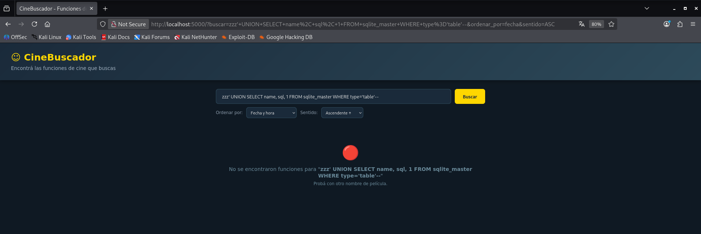


## Ejercicio 2 - Cross Site Scripting (XSS)

### Descripción de la aplicación

Esta aplicación es la de CineBuscador del ejercicio anterior con algunos añadidos. Además de buscar funciones de cine, ahora cada película tiene una descripción y una página de edición (`/edit/<id>`) para cambiar el nombre, el género, el director y la descripción de la película. Los cambios se guardan en la base de datos y después se muestran en el buscador y en la página de edición.

### Identificación de la vulnerabilidad

Después de revisar el código del ejercicio, encontré que la vulnerabilidad estaba en el archivo `edit.html`, en la parte que muestra la vista previa de la descripción actual:

```html
{{ pelicula['descripcion'] | safe }}
```

En este ejercicio no me daba cuenta dónde era que estaba el problema, por eso me apoyé en la IA para encontrarlo. Buscando información y con ayuda de la IA llegué a que el problema era el filtro `| safe`, ya que normalmente Flask (mediante su motor de plantillas Jinja) transforma los caracteres especiales de lo que se inserta en la página (convirtiendo por ejemplo `<` en `&lt;`), justamente para evitar este tipo de ataques, pero el `| safe` desactiva esa transformación y hace que el valor se inserte tal cual está. Como la descripción la controla el usuario (puede editarla y queda guardada en la base), si se guarda un código JavaScript en ese campo, al abrir la página de edición se ejecuta el código en el navegador. Esto sería un XSS almacenado, porque lo ingresado queda guardado en la base y se dispara cada vez que se abre la opción de editar de esa película. Aprovechando de nuevo las presentaciones de clase, esta vulnerabilidad entra en la weakness CWE-79 de Cross Site Scripting.

Como detalle que vi, en la página principal (`index.html`) la descripción se muestra sin el `| safe`, entonces ahí Flask sí transforma los caracteres especiales y el código queda como texto sin ejecutarse. El XSS pasa solo en la página de edición.

### Prueba de concepto (PoC)

Primero levanté la aplicación desde la carpeta del ejercicio (frené antes el contenedor del ejercicio 1, porque me dio problemas, ya que usan el mismo puerto):

```bash
cd /home/kali/practico2/Ejercicio2
docker compose up --build
```

Con el contenedor corriendo entré desde el Firefox a `http://localhost:5000` y busqué una película para ver las descripciones y el link de "Editar".

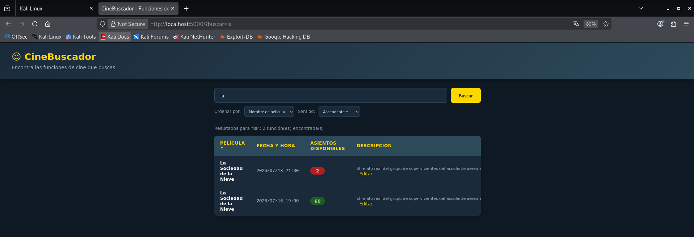

#### **2.1. Guardar el payload en la descripción.**

Entré a la edición de una película (con el link "Editar") y en el campo Descripción puse el código siguiente:

```html
<script>alert('XSS')</script>
```

Después le di a "Guardar cambios", guardando la descripción en la base y redirigiéndome al buscador.

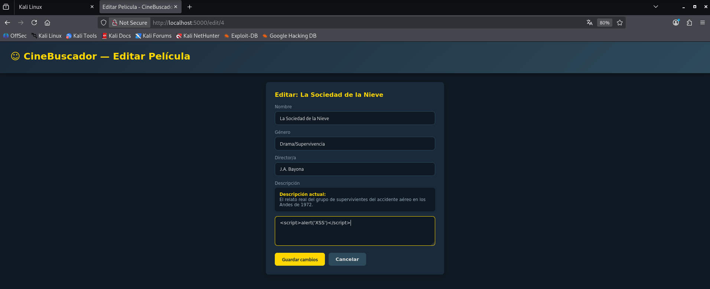

#### **2.2. Disparar el XSS almacenado.**

Volví a abrir la página de edición de esa misma película. Al cargar la página de edición se ejecutó el código guardado y saltó el `alert`, mostrando el XSS.

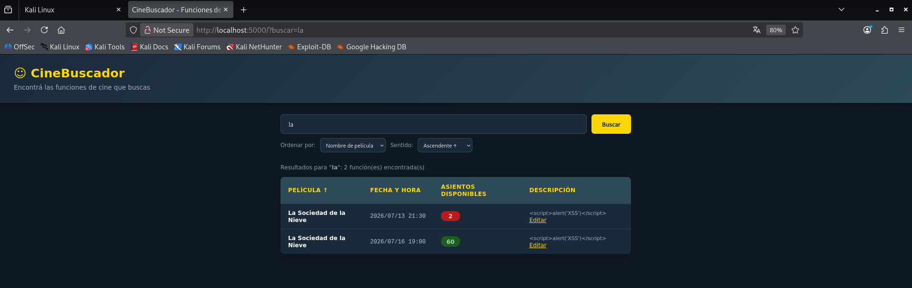

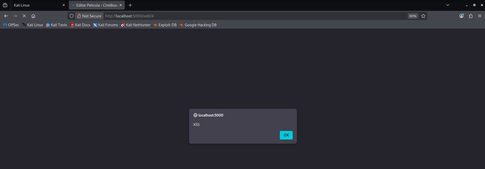

### Impacto de la vulnerabilidad

Como el código queda guardado en la base, el XSS se ejecuta en el navegador de cualquier persona que abra la página de edición de esa película. Con eso un atacante podría robar cookies de sesión, redirigir al usuario a un sitio falso o modificar el contenido de la página.


### Mitigación

El XSS venía del filtro `| safe` en el archivo `edit.html`, que desactivaba el escaping (la transformación de caracteres especiales que mencioné antes) de la descripción. La versión vulnerable era esta:

```html
<div class="prev-descripcion">
    <strong>Descripción actual:</strong><br>
    {{ pelicula['descripcion'] | safe }}
</div>
```

La corrección fue solo sacarle el `| safe`:

```html
<div class="prev-descripcion">
    <strong>Descripción actual:</strong><br>
    {{ pelicula['descripcion'] }}
</div>
```

Al sacar el `| safe`, Flask (mediante Jinja) vuelve a hacer el escaping automáticamente a la descripción, transformando los caracteres especiales (por ejemplo `<` en `&lt;`). De esta forma, si alguien guarda un código como `<script>` en la descripción, al abrir la página de edición se muestra ese código en pantalla como texto y el navegador ya no lo ejecuta.

#### Verificación

Después de aplicar el cambio reconstruí la imagen y volví a levantar el contenedor:

```bash
docker compose up --build
```

Con la app corriendo, volví a guardar el código `<script>alert('XSS')</script>` en la descripción de una película.

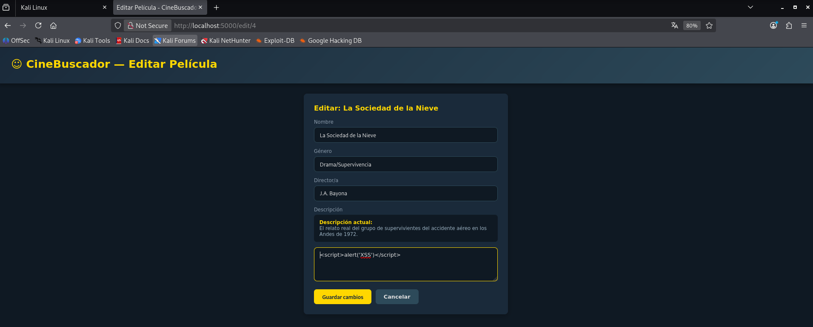

Volví a abrir la página de edición de esa película y en lugar de ejecutarse, el código se muestra como texto en el recuadro de "Descripción actual", confirmando que el XSS quedó mitigado.

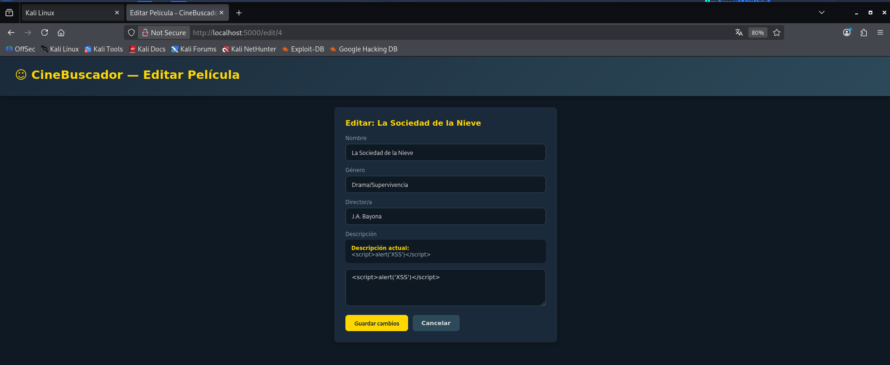


## Ejercicio 3 - File Upload

### Descripción de la aplicación

Como en los dos ejercicios anteriores, esta aplicación es otra versión del CineBuscador, pero hecha en Java con Spring Boot (usando plantillas Thymeleaf) en vez de usar Python. Además de buscar películas, cada película tiene un botón de "Subir afiche" (`/upload/{id}`) que permite subir un archivo de imagen. El archivo subido se guarda en el servidor y después se muestra como el afiche de la película, usando la ruta `/uploads/{nombre}`.

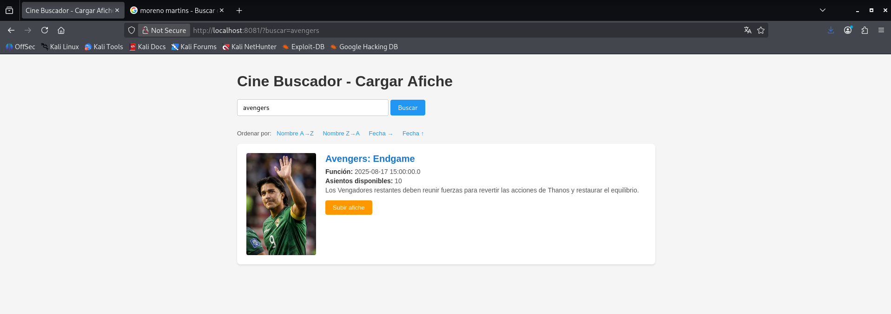

### Identificación de la vulnerabilidad

Estuve buscando bastante dónde podía estar la vulnerabilidad, pero no pude dar con el problema yo solo, por eso de nuevo me tuve que apoyar en la IA para encontrarlo. Buscando información y preguntando a la IA llegué a que la vulnerabilidad estaba en el archivo `PeliculaController.java`, en el método que guarda el archivo subido:

```java
String filename = archivo.getOriginalFilename();
Path uploadPath = Paths.get(uploadDir);
if (!Files.exists(uploadPath)) {
    Files.createDirectories(uploadPath);
}
Files.copy(archivo.getInputStream(), uploadPath.resolve(filename));

pelicula.setAfichePath(filename);
```

El problema era que la aplicación no validaba nada del archivo que se sube, ya que no chequea la extensión, ni el tipo real (content-type), ni el contenido, ni el tamaño. Por lo tanto se podía subir cualquier tipo de archivo, en lugar de solo imágenes como debía ser. El formulario también lo muestra, porque el `<input type="file">` tiene `accept="*/*"`. Esta falta de validación se correspondería con la weakness CWE-434 (Unrestricted Upload of File with Dangerous Type).

A este primer problema se le suma el cómo se expone el archivo después. En el método que lo devuelve (`/uploads/{filename}`), la aplicación le pone el content-type según la extensión del archivo y lo entrega con `Content-Disposition: inline`. Por esto, si se sube un archivo `.html`, la aplicación lo devuelve como una página HTML que el navegador ejecuta en el mismo dominio de la aplicación.

Usando estos dos problemas en conjunto se puede subir un archivo HTML con JavaScript adentro, que al abrirlo se ejecute el código.

Como detalle extra, la aplicación también usa el nombre original del archivo tal cual (`getOriginalFilename()`) para guardarlo, lo que podría permitir un path traversal (el CWE-22) con un nombre del estilo de `../../algo`, con el que se podría escribir el archivo por fuera de la carpeta de subidas.

### Prueba de concepto (PoC)

Primero levanté la aplicación desde la carpeta del ejercicio. En este ejercicio tuve que cambiar en el `docker-compose.yml` el puerto publicado a `8081`, porque el `8080` lo tenía ocupado con el proxy de Burp:

```bash
cd /home/kali/practico2/Ejercicio3
docker compose up --build
```

Con el contenedor corriendo entré desde el Firefox a `http://localhost:8081`, donde cargó la app con las películas y el botón de "Subir afiche".

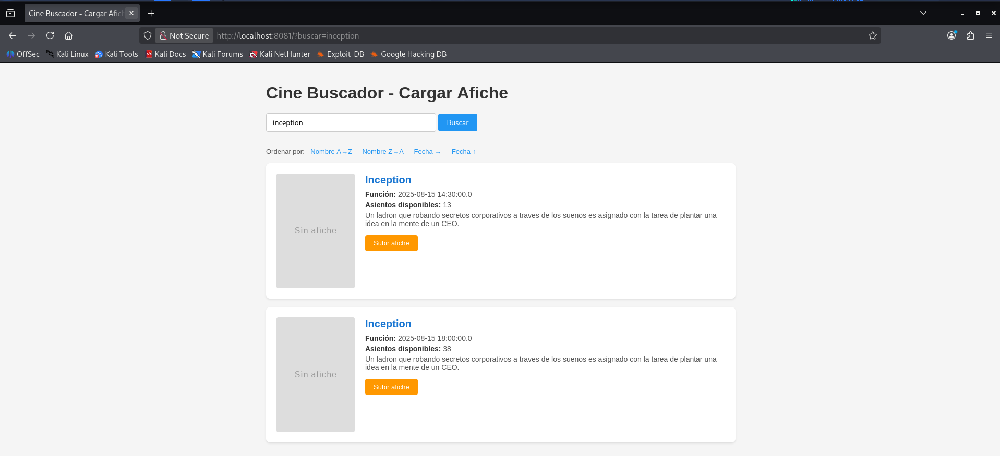

#### **3.1. Crear un archivo malicioso.**

En una terminal de Kali creé un archivo HTML con un JavaScript adentro, para subirlo después como si fuera un afiche:

```bash
echo "<script>alert('XSS via File Upload - '+document.domain)</script>" > /home/kali/poc.html
```

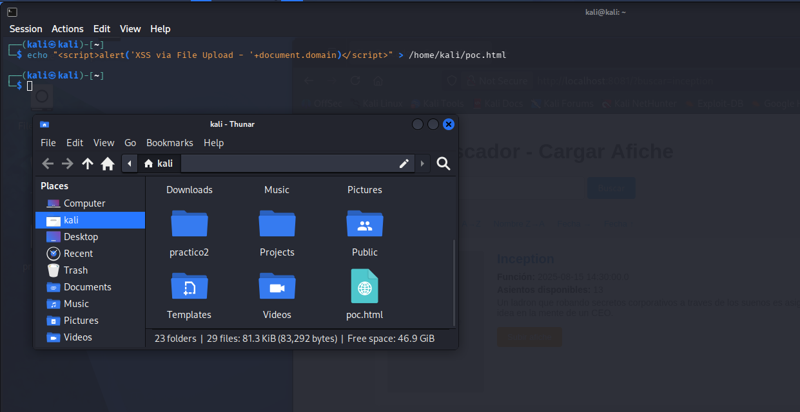

#### **3.2. Subir el archivo.**

Entré al formulario de subida de la película de Inception (`http://localhost:8081/upload/1`), seleccioné el archivo `poc.html` y le di a "Subir afiche". La aplicación lo guardó igual siendo un `.html` y no una imagen como debería ser.

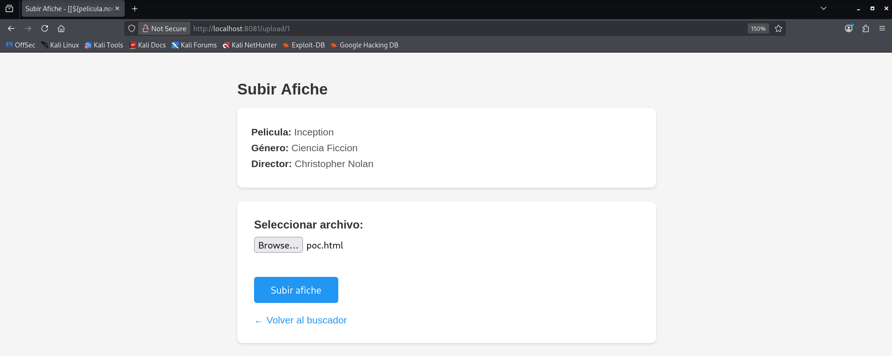

#### **3.3. Ejecutar el archivo subido.**

Después fui directamente al archivo que se había subido en:

```
http://localhost:8081/uploads/poc.html
```

La aplicación me devolvió el archivo como HTML y se ejecutó el script, mostrando el `alert` con el dominio de la aplicación. Confirmando con esto que se puede subir y ejecutar código arbitrario en la app.

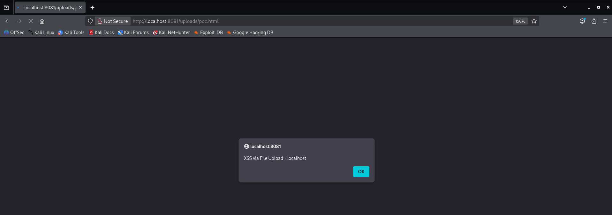

### Impacto de la vulnerabilidad

Al no haber una validación del tipo de archivo, un atacante puede subir HTML o JavaScript y hacer que la aplicación lo exponga desde su propio dominio. Con eso el atacante podría robar cookies de sesión o armar una página de phishing dentro del dominio real de la aplicación. Además, al usar el nombre original del archivo sin validarlo, se habilita un path traversal que permitiría escribir archivos fuera de la carpeta de subidas.

### Mitigación

Todos los cambios para mitigar la vulnerabilidad los hice en el archivo `PeliculaController.java`.

#### Validación y cambio de nombre del archivo subido

La versión vulnerable tomaba el nombre original del archivo y lo guardaba sin validar:

```java
String filename = archivo.getOriginalFilename();
Path uploadPath = Paths.get(uploadDir);
if (!Files.exists(uploadPath)) {
    Files.createDirectories(uploadPath);
}
Files.copy(archivo.getInputStream(), uploadPath.resolve(filename));

pelicula.setAfichePath(filename);
```

Modifiqué esa parte de la siguiente forma:

```java
if (archivo.isEmpty()) {
    throw new IllegalArgumentException("El archivo está vacio");
}

// Whitelist de extensiones de imagen
List<String> extensionesPermitidas = List.of("png", "jpg", "jpeg", "gif");

String originalName = archivo.getOriginalFilename();
String extension = "";
if (originalName != null && originalName.contains(".")) {
    extension = originalName.substring(originalName.lastIndexOf('.') + 1).toLowerCase();
}
if (!extensionesPermitidas.contains(extension)) {
    throw new IllegalArgumentException("Tipo de archivo no permitido");
}

// Validación de que el contenido sea una imagen
byte[] contenido = archivo.getBytes();
BufferedImage imagen = ImageIO.read(new ByteArrayInputStream(contenido));
if (imagen == null) {
    throw new IllegalArgumentException("El archivo no es una imagen válida");
}

// Nombre nuevo aleatorio (descartando el original)
String nuevoNombre = UUID.randomUUID().toString() + "." + extension;

Path uploadPath = Paths.get(uploadDir);
if (!Files.exists(uploadPath)) {
    Files.createDirectories(uploadPath);
}

Path destino = uploadPath.resolve(nuevoNombre).normalize();
if (!destino.startsWith(uploadPath)) {
    throw new IllegalArgumentException("Ruta inválida");
}
Files.write(destino, contenido);

pelicula.setAfichePath(nuevoNombre);
```

Los cambios implementados hacen lo siguiente:

- **Whitelist de extensiones:** solo se aceptan extensiones de imagen (`png`, `jpg`, `jpeg`, `gif`).

- **Validación del contenido real:** después de revisar la extensión, intento decodificar el archivo como imagen con `ImageIO`. Implementé este control con ayuda de la IA, al ver que con esto evito el truco de renombrar un `.html` a `.png`.

- **Nombre nuevo con UUID:** descarto el nombre original que mandó el usuario y se guarda el archivo con un nombre aleatorio más la extensión validada. Evitando con esto el path traversal de escritura y haciendo que el archivo no se pueda exponer como HTML.

#### Contención de ruta al exponer el archivo

El método que expone los archivos (`serveFile`) resolvía el nombre que venía en la URL sin verificar que quedara dentro de la carpeta de subidas, permitiendo un path traversal de lectura. La línea vulnerable era:

```java
Path filePath = Paths.get(uploadDir).resolve(filename).normalize();
```

La cambié para que verifique que la ruta final quede dentro de la carpeta de subidas:

```java
Path uploadPath = Paths.get(uploadDir).toAbsolutePath().normalize();
Path filePath = uploadPath.resolve(filename).normalize();
if (!filePath.startsWith(uploadPath)) {
    return ResponseEntity.badRequest().build();
}
```

Con estos cambios, si el nombre está hecho para salir de la carpeta (con `../`), la aplicación responde con un error en vez de devolver el archivo.

#### Verificación

Después de aplicar los cambios reconstruí la imagen y volví a levantar el contenedor:

```bash
docker compose up --build
```

Primero volví a intentar subir el archivo `poc.html` en el formulario de subida:

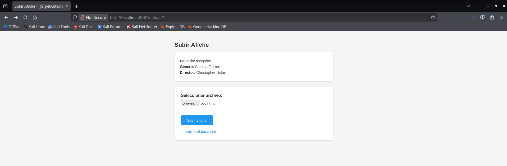

Esta vez la aplicación lo rechazó, mostrando una página de error en lugar de guardarlo:

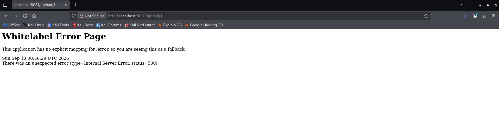

Después subí una imagen real, que se guardó y se mostró correctamente como afiche de la película, mostrando que la funcionalidad esperada sigue andando:

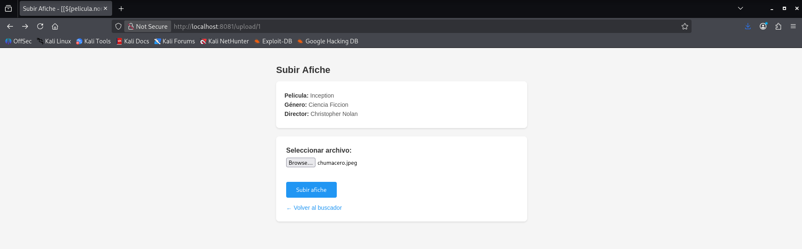

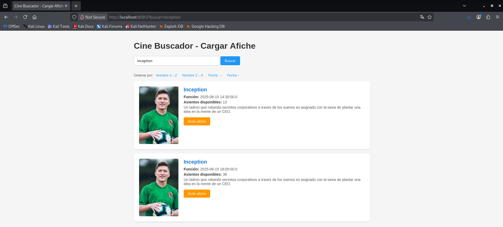

Por último probé el path traversal de lectura, pidiendo una ruta que intenta salir de la carpeta de subidas, pero esta vez la aplicación respondió con un error 400 en vez de devolver un archivo:

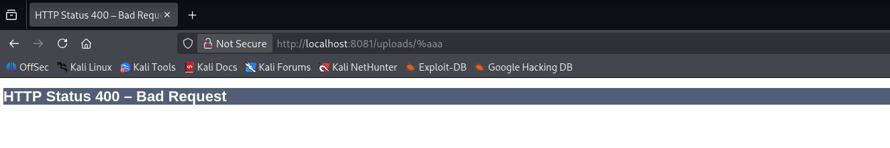


## Ejercicio 4 – Server Side Template Injection

### Descripción de la aplicación

La aplicación de este ejercicio es otro buscador de funciones de cine hecho en Java con Spring Boot. Lo que tiene de distinto a las aplicaciones anteriores es que lo que se escribe en el cuadro de búsqueda, en vez de usarse como texto para filtrar, se evalúa como una expresión de SpEL (Spring Expression Language) en el servidor. El resultado de esa evaluación es lo que se usa después para buscar y mostrar en la página.

### Identificación de la vulnerabilidad

El ejercicio ya avisaba en la página misma que tenía una vulnerabilidad de SSTI, pero para entender bien dónde y cómo era que se aprovechaba esa vulnerabilidad, me apoyé en la IA. Con ayuda de la IA y buscando entre los archivos llegué a que el problema estaba en el archivo `SpelEvaluator.java`, por como evalúa la expresión:

```java
// Acá crea un contexto seguro que después no usa.
EvaluationContext context = SimpleEvaluationContext.forReadOnlyDataBinding().build();

// y acá es que usa el contexto peligroso.
StandardEvaluationContext standardContext = new StandardEvaluationContext();
standardContext.setVariable("system", System.class);
standardContext.setVariable("runtime", Runtime.class);

var expr = parser.parseExpression(expression);
Object result = expr.getValue(standardContext);
```

Y en `FuncionController.java` lo que se busca se pasa directo a evaluar:

```java
String spelResultado = spelEval.evaluate(buscar);
```

El problema de esto es que la aplicación toma el texto del usuario y lo evalúa como una expresión de SpEL usando un `StandardEvaluationContext`, que es el contexto que permite hacer llamadas a métodos, referenciar clases con `T(...)` o crear objetos y más cosas. Además, el código crea un SimpleEvaluationContext (que sería el seguro) pero no lo usa y encima expone las clases System y Runtime como variables. Esta "Server Side Template Injection" corresponde a la weakness CWE-917 (Expression Language Injection).

### Prueba de concepto (PoC)

Primero levanté la aplicación desde la carpeta del ejercicio (de nuevo como en el ejercicio 3, le cambié el puerto a `8081` en el `docker-compose.yml`, porque el `8080` lo tenía ocupado con Burp):

```bash
cd /home/kali/practico2/Ejercicio4
docker compose up --build
```

Con el contenedor corriendo entré desde el Firefox a `http://localhost:8081`, donde cargó el buscador de funciones.

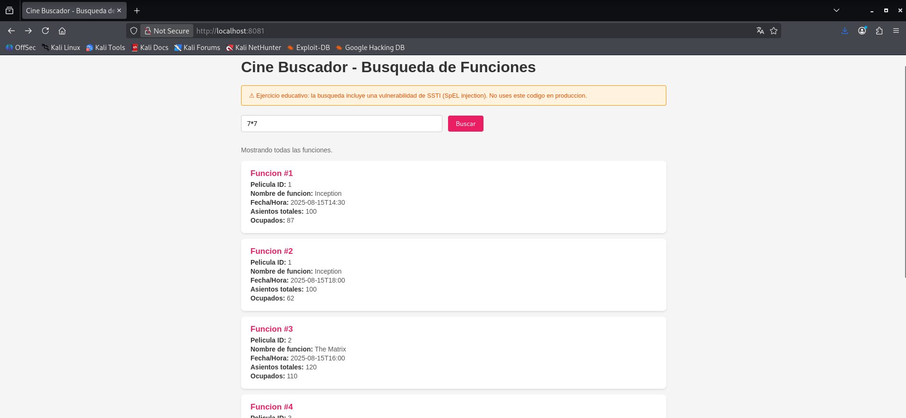

#### **4.1. Confirmar que evalúa expresiones.**

En el cuadro de búsqueda escribí una multiplicación fácil para probar:

```
5*5
```

La página mostró el mensaje de "Resultados buscando por: 25". Al devolver `25` en vez de buscar el texto "5*5", queda claro que la entrada se evalúa como una expresión en el servidor.

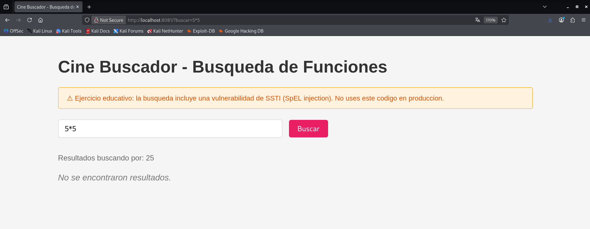

#### **4.2. Acceder a información del sistema.**

Después usé una expresión para leer datos del servidor:

```
#system.getProperty('os.name')
```

La página mostró el sistema operativo del servidor (Linux), confirmando que se puede acceder a información interna a través de la expresión.

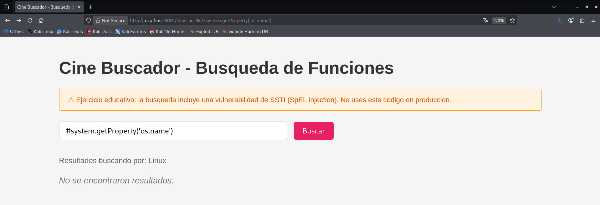

#### **4.3. Ejecutar código para leer un archivo del sistema.**

Como última prueba ingresé una expresión que ejecuta código Java para leer un archivo del servidor:

```
new String(T(java.nio.file.Files).readAllBytes(T(java.nio.file.Paths).get('/etc/passwd')))
```

La página mostró el contenido del archivo `/etc/passwd`. Mostrando que la inyección permite ejecutar código arbitrario en el servidor y acceder a archivos internos del sistema.

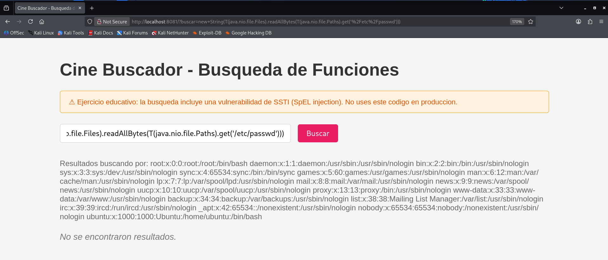

### Impacto de la vulnerabilidad

Al evaluar la entrada del usuario como una expresión de SpEL con un contexto sin restricciones, un atacante puede ejecutar código arbitrario en el servidor sin ninguna autenticación, teniendo solamente que escribir una expresión en el cuadro de búsqueda. Con esto se puede leer un archivo del sistema, pero además se pueden leer variables de entorno y credenciales, acceder a la base de datos o usar el servidor como un punto de entrada para comprometer otras partes de la infraestructura. Claramente es el impacto más grave posible, al dar control total sobre el servidor.

### Mitigación

La vulnerabilidad estaba en que la aplicación evaluaba el texto de la búsqueda como una expresión de SpEL. Como una búsqueda no necesita evaluar ninguna expresión, la forma de mitigación que tomé fue dejar de evaluar SpEL y usar el texto ingresado como término de búsqueda. Todos los cambios los hice en el archivo `FuncionController.java`.

El cambio principal que hice fue en la línea que evaluaba la expresión:

```java
// Antes
String spelResultado = spelEval.evaluate(buscar);
```

```java
// Después
String spelResultado = buscar;
```

Con este cambio el término de búsqueda pasa a ser el texto como lo escribió el usuario y el resto del método lo usa para filtrar por texto como una búsqueda normal.

Al dejar de usar el código que evaluaba la expresión, eliminé la clase que hacía la evaluación (`SpelEvaluator`) y todas las referencias a esa clase en el controlador (el import, el campo y el parámetro del constructor).

- Borré el archivo `SpelEvaluator.java`.

- En `FuncionController.java` saqué el import de `SpelEvaluator`, el campo `spelEval`, su asignación en el constructor y el parámetro correspondiente.

Con estos cambios la aplicación ya no tiene ningún punto en el que se evalúe la entrada del usuario como una expresión.

### Verificación

Después de aplicar los cambios reconstruí la imagen y volví a levantar el contenedor (usando `down` antes del `up` para limpiar lo que había quedado del contenedor previo):

```bash
docker compose down
docker compose up --build
```

Con la aplicación corriendo, repetí las mismas pruebas de la PoC. Primero busqué `5*5` y en lugar de devolver `25`, la aplicación lo tomó como texto literal y me mostró "Resultados buscando por: 5*5", pudiendo confirmar que ya no evalúa la expresión:

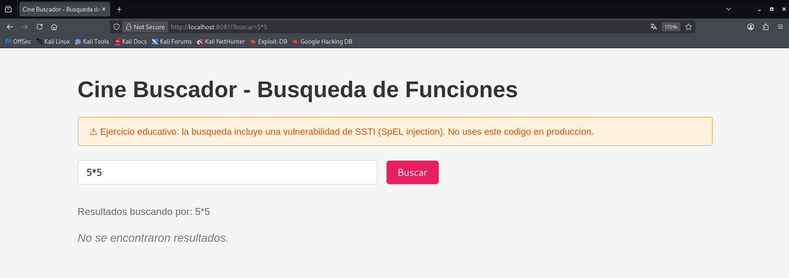

Después probé el mismo comando de antes que ejecutaba un código para leer `/etc/passwd`:

```
new String(T(java.nio.file.Files).readAllBytes(T(java.nio.file.Paths).get('/etc/passwd')))
```

Esta vez la aplicación lo buscó como texto literal, confirmando con eso que la vulnerabilidad quedó mitigada:

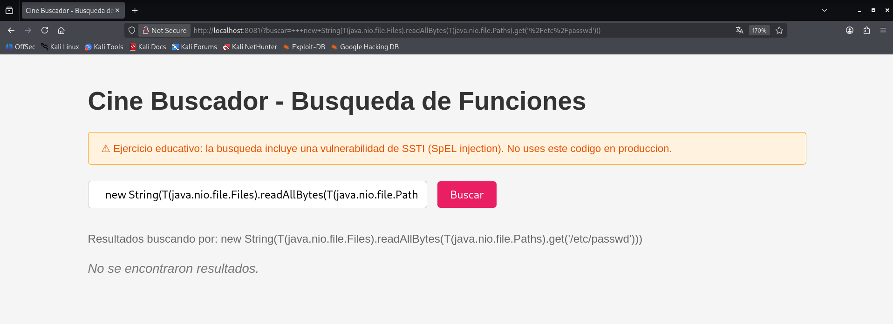


## Ejercicio 5 - Almacenamiento inseguro

### Descripción de la aplicación

Esta aplicación es un login y registro de usuarios hecho en Java con Spring Boot. Después de registrarse, la aplicación guarda el usuario y su contraseña en una base de datos, luego al iniciar sesión muestra la contraseña "cifrada" como quedó almacenada.

### Identificación de la vulnerabilidad

El almacenamiento de las contraseñas está en el archivo `EncryptionService.java`. Buscando información y consultando con la IA, vi que la idea o el objetivo sería que una contraseña no debería poder recuperarse, por eso lo correcto sería guardarla hasheada (siendo el hash una función de una sola vía, ya que de la contraseña se obtiene el hash pero del hash no se puede volver a la contraseña). En este ejercicio las contraseñas se guardan cifradas, siendo un proceso reversible, ya que con la clave se puede volver a la contraseña original. Esto se puede ver en el login, que descifra la contraseña guardada para compararla (en `AuthController.java`):

```java
String decryptedPassword = EncryptionService.decrypt(user.getPassword());
```

Guardar las contraseñas de una forma que se pueda revertir se corresponde con la weakness CWE-257 (Storing Passwords in a Recoverable Format).

A eso se le suman dos problemas más en `EncryptionService.java`:

- *Clave de cifrado embebida en el código* (CWE-321), lo que hace que cualquiera con acceso al código pueda descifrar todas las contraseñas:

```java
private static final String SECRET_KEY = "MySup3rS3cr3tK3y!2024CineBuscadorAES";
```

- *Uso del modo ECB* (CWE-327), que es determinístico, ya que la misma contraseña siempre produce el mismo texto cifrado:

```java
private static final String CIPHER_ALGO = "AES/ECB/PKCS5Padding";
```

### Prueba de concepto (PoC)

Primero levanté la aplicación desde la carpeta del ejercicio (también le cambié el puerto a `8081` en el `docker-compose.yml`, y usé `down` antes del `up` para arrancar desde cero):

```bash
cd /home/kali/practico2/Ejercicio5
docker compose down
docker compose up --build
```

Con el contenedor corriendo entré desde el Firefox a `http://localhost:8081`, donde cargó la pantalla de login/registro.

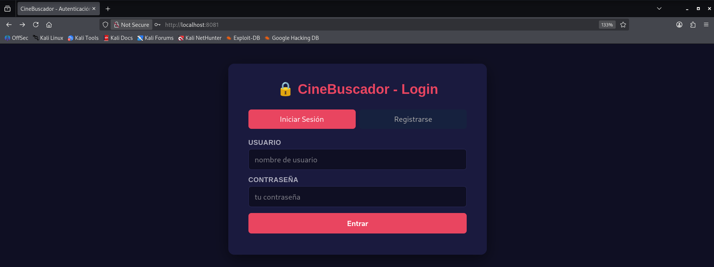

#### **5.1. Registrar un usuario y ver la contraseña cifrada.**

Me registré con el usuario `Peteco` y la contraseña `Peteco123`. Al iniciar sesión con un usuario, la aplicación muestra la contraseña ya cifrada (con un texto en Base64), que es como queda guardada en la base:


#### **5.2. Recuperar la contraseña original.**

Como la clave de cifrado está dentro del código, se puede descifrar la contraseña guardada y volverla al texto plano. Usando esa clave y con ayuda de la IA para armar el comando, descifré el texto cifrado en una terminal de Kali con OpenSSL:

```bash
KEYHEX=$(printf '%s' 'MySup3rS3cr3tK3y!2024CineBuscadorAES' | head -c 32 | xxd -p | tr -d '\n')
echo 'WWacS7xtheH8c1mht/443Q==' | base64 -d | openssl enc -aes-256-ecb -d -nosalt -K "$KEYHEX"
```

El comando toma los primeros 32 bytes de la clave del código, los pasa a hexadecimal y con eso descifra el texto en Base64. El resultado como era esperable fue la contraseña original `Peteco123`, quedando demostrado que el almacenamiento es inseguro al poder recuperar en texto plano las contraseñas.

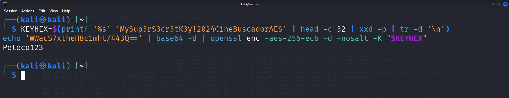

#### **5.3. Demostrar el problema del modo ECB.**

Para mostrar el problema del modo ECB, registré un segundo usuario, `Juanito`, con la misma contraseña `Peteco123`. Al ser cifrado determinístico, la contraseña cifrada de los dos usuarios quedó exactamente igual:

```
Contraseña en texto plano (de los dos usuarios): Peteco123

Peteco    -->  WWacS7xtheH8c1mht/443Q==
Juanito   -->  WWacS7xtheH8c1mht/443Q==
```

Esto no debería pasar con un almacenamiento seguro, dado que un hash con salt haría que dos usuarios con la misma contraseña tuvieran valores distintos. Mientras que en este caso, se puede saber qué usuarios comparten contraseña con solo mirar la base.

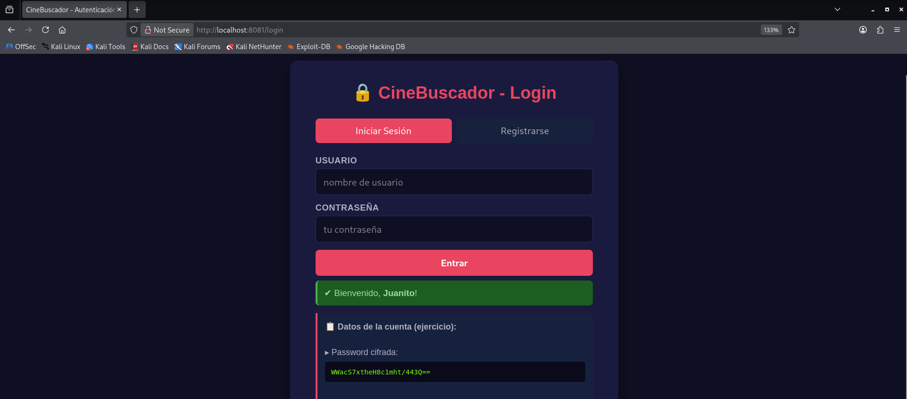

### Impacto de la vulnerabilidad

Si un atacante consigue acceso a la base de datos (por ejemplo a través de otra vulnerabilidad, un backup filtrado o un acceso indebido), puede recuperar todas las contraseñas en texto plano, porque el cifrado es reversible y la clave está en el código. Sumado a eso, por el uso del modo ECB, puede identificar qué usuarios comparten la misma contraseña. Este acceso a contraseñas puede afectar aún más a personas registradas en la app que no tengan contraseñas distintas para cada servicio, pudiendo comprometer cuentas de usuarios en otras páginas, como en cuentas de banco, tarjetas, correos y más servicios.

### Mitigación

La solución que tomé fue dejar de cifrar las contraseñas (que es un proceso reversible) y pasar a hashearlas con bcrypt, que es una función de una sola vía (o sea que no se puede volver a la contraseña) y que además usa un salt aleatorio (el salt es un valor aleatorio distinto que se agrega a cada contraseña antes de hashearla para que dos contraseñas iguales generen distintos hashes) por cada contraseña. Con esto resuelvo los tres problemas de una, mitigando el almacenamiento reversible, la clave embebida y el modo ECB.

Los cambios que hice fueron:

Primero, en el `pom.xml` agregué la dependencia que trae el `BCryptPasswordEncoder`:

```xml
<dependency>
    <groupId>org.springframework.security</groupId>
    <artifactId>spring-security-crypto</artifactId>
</dependency>
```

En `AuthController.java` agregué el encoder como campo:

```java
private final BCryptPasswordEncoder passwordEncoder = new BCryptPasswordEncoder();
```

En el registro, ahora hasheo la contraseña con bcrypt (en lugar de cifrarla):

```java
// Antes
nuevoUsuario.setPassword(EncryptionService.encrypt(password));

// Después
nuevoUsuario.setPassword(passwordEncoder.encode(password));
```

Y en el login, en vez de descifrar la contraseña guardada para compararla, uso `matches`, con el que compara la contraseña ingresada contra el hash almacenado:

```java
// Antes
String decryptedPassword = EncryptionService.decrypt(user.getPassword());
if (password.equals(decryptedPassword)) { ... }

// Después
if (user != null && passwordEncoder.matches(password, user.getPassword())) { ... }
```

Por último, al no usarlo más en el código, eliminé el archivo `EncryptionService.java` (dejando de estar la clave embebida y el cifrado reversible) y su import en el controlador.

### Verificación

Después de aplicar los cambios reconstruí la imagen y volví a levantar el contenedor (usando `down` antes del `up` para arrancar desde cero):

```bash
docker compose down
docker compose up --build
```

Con la aplicación corriendo, registré de nuevo los usuarios `Peteco` y `Juanito`, los dos con la misma contraseña `Peteco123`. Al iniciar sesión con cada uno, la contraseña almacenada que muestra la aplicación ya no es un texto cifrado en Base64, sino un hash bcrypt (empieza con `$2a$`):

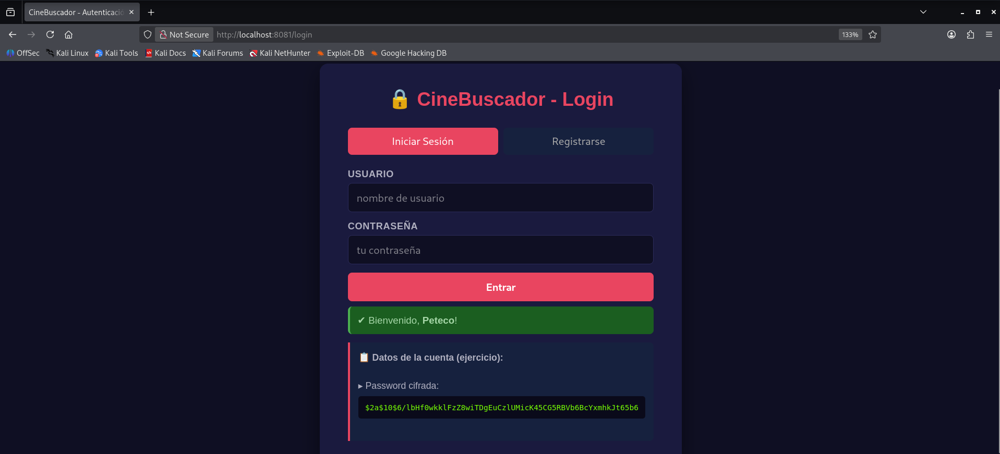

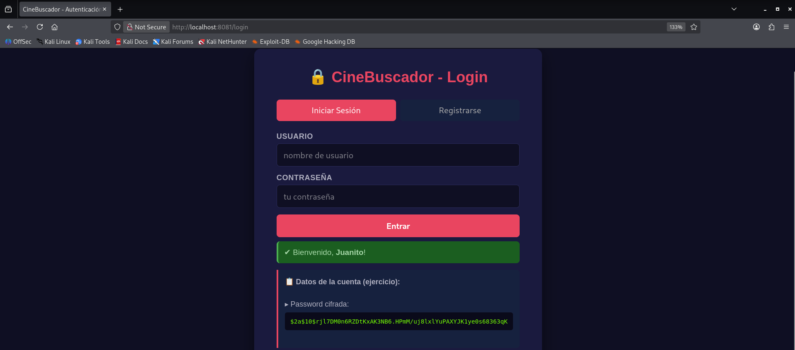

Al contrario de lo que pasaba antes con el modo ECB (donde la misma contraseña daba el mismo cifrado), ahora los dos usuarios con la misma contraseña, tienen hashes distintos por el salt:

```
Contraseña en texto plano (los dos usuarios): Peteco123

Peteco    -->  $2a$10$6/lbHf0wkklFzZ8wiTDgEuCzlUMicK45CG5RBVb6BcYxmhkJt65b6
Juanito   -->  $2a$10$rjl7DM0n6RZDtKxAK3NB6.HPmM/uj8lxlYuPAXYJK1ye0s68363qK
```

Como el hash es de una sola vía, ya no se puede recuperar la contraseña original y como cada usuario tiene su propio salt, tampoco se puede saber cuáles comparten contraseña. El login sigue funcionando bien, validando la contraseña ingresada contra el hash con `matches`.